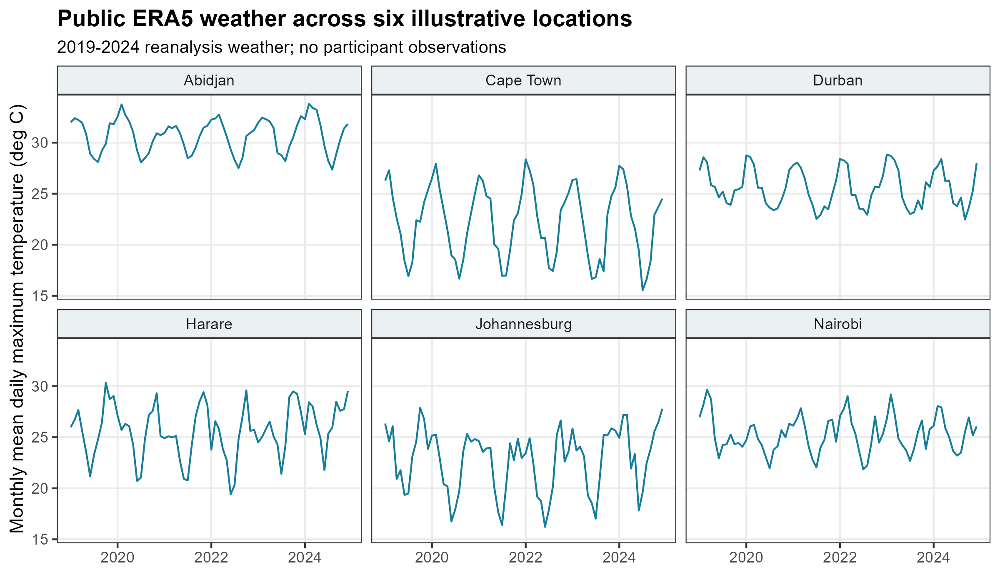
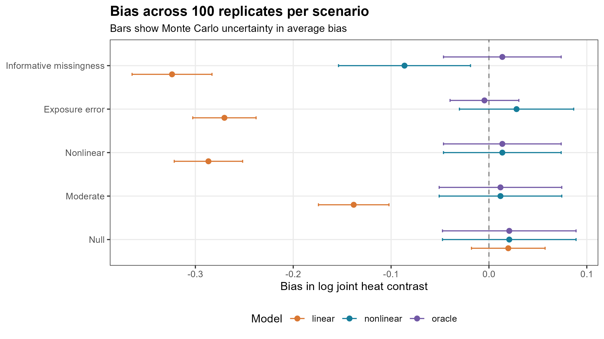
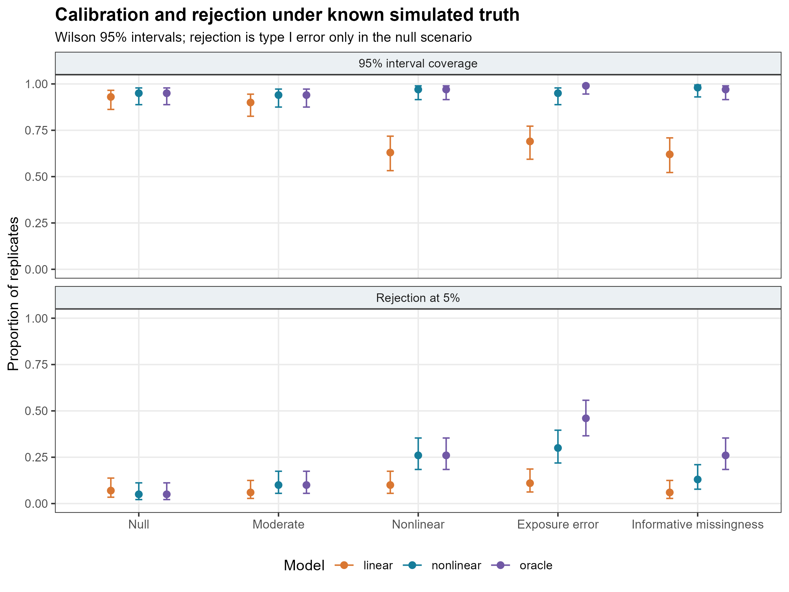
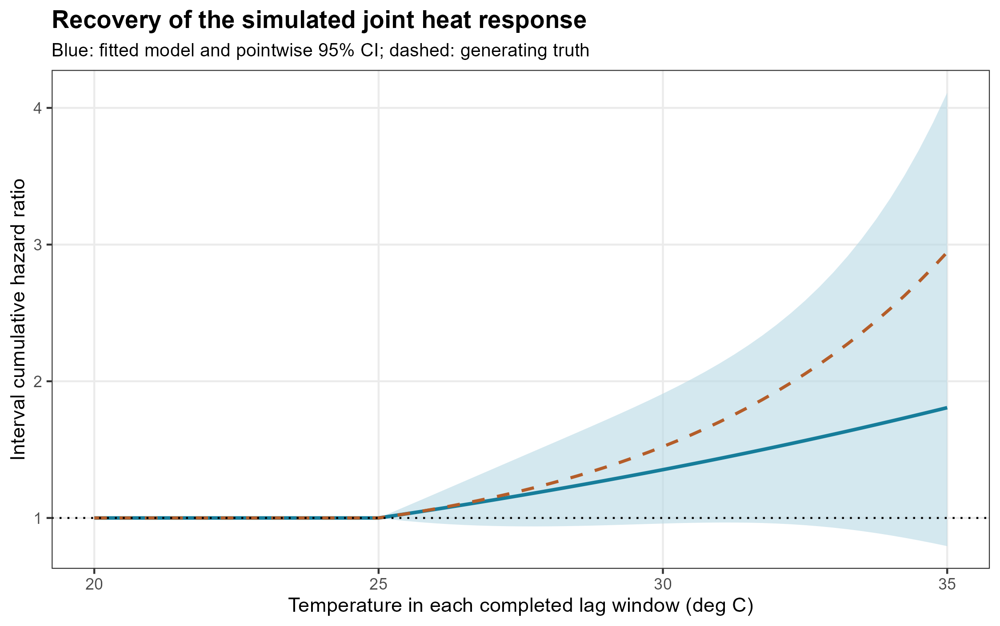
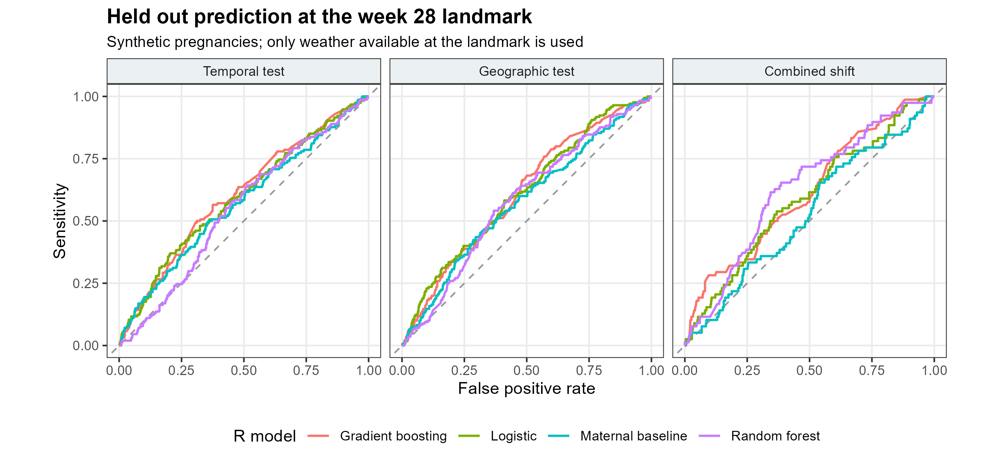
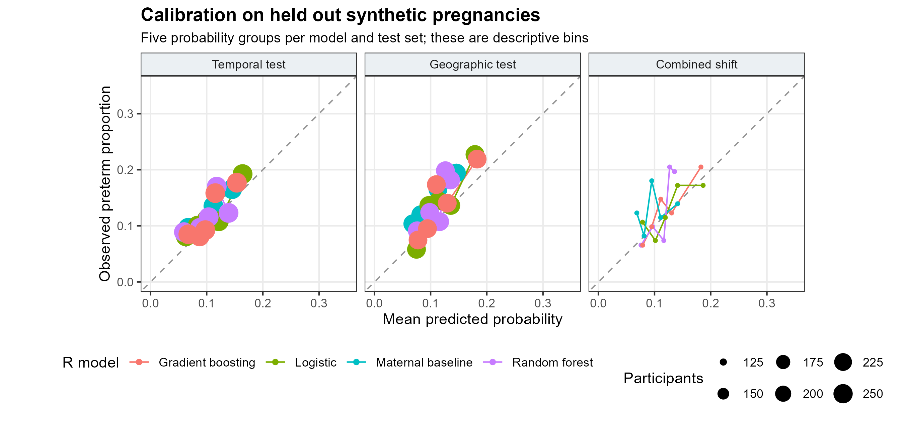

**Simulation study using public weather and entirely synthetic pregnancies and outcomes**

```{r}
stopifnot(file.exists('../results/validation.json'))
```

## Abstract

**Background.** Heat and pregnancy research requires methods that respect gestational risk sets, delayed exposure effects and the distinction between association and prediction. This study evaluated such methods using public historical weather and entirely synthetic pregnancies.

**Methods.** ERA5 reanalysis weather from six African locations during 2019–2024 informed 100 independently seeded cohorts of 1,800 pregnancies. Five paired scenarios represented a null effect, a moderate heat effect, nonlinear delayed effects, unobserved personal exposure and outcome-dependent missingness. Complementary log-log weekly survival models were implemented independently in R and Python. An additional 6,000-pregnancy cohort supported week-28 prediction with maternal-only ridge logistic regression, weather-augmented ridge regression, Random Forest and gradient boosting. Temporal, geographic and combined test sets were held out.

**Results.** All 1,500 fit records per language converged. The correctly specified nonlinear model had 5% null rejection and 97% interval coverage in the nonlinear scenario. R model AUCs ranged from 0.530 to 0.629 across held-out tests; this represents modest discrimination in the simulated prediction problem.

**Conclusions.** This is an implementation and performance study under known simulated mechanisms. It does not estimate clinical effects in African populations or validate an operational heat-warning system. Performance depends on exposure measurement, missingness and the prediction setting; additional model complexity does not guarantee better prediction.

## Introduction

Ambient heat is a relevant maternal and newborn health exposure. A systematic review reported associations between higher temperatures and adverse pregnancy outcomes, including preterm birth [1]. These findings motivate careful study designs; they do not establish the numerical parameters used in the present simulations. Wits Planetary Health Research describes programmes addressing heat, maternal health and early warning, including HEAT Center and Bio-HEAT [2,3]. This independent methodological portfolio study is motivated by those topics and has no affiliation with, access to, or validation against their participant data.

Three statistical questions are distinguished. First, can a time-indexed model recover a known heat association without using exposure after delivery? Second, how does recovery change when ambient weather differs from personal exposure or when exposure records are selectively missing? Third, can information available at a pregnancy landmark predict later preterm delivery in different years and locations? A final explanatory exercise examines model-standardised risks under a hypothetical reduction in temperature. The study was designed to evaluate these questions rather than maximise the apparent performance of one algorithm.

## Methods

### Design and data provenance

Daily maximum and minimum air temperature and precipitation were obtained through the Open-Meteo Historical Weather API with explicit ERA5 model selection [4]. The locations were Johannesburg, Durban, Cape Town, Harare, Nairobi and Abidjan. Each location contributed 2,192 consecutive days from 1 January 2019 to 31 December 2024, giving 13,152 site-days. API queries, source hashes, returned coordinates and time zones are retained in the provenance directory. The source is gridded reanalysis; it does not measure individual heat exposure. These illustrative city coordinates are not recruitment sites.

Checks required complete consecutive dates, finite temperatures and precipitation, minimum temperature no greater than maximum temperature, plausible temperature bounds and nonnegative rainfall. An initial ERA5-Land query returned unavailable precipitation; the final study therefore uses a consistent ERA5 product across all sites, without filling the missing weather values. Monthly weather summaries describe the exposure environment but are not evidence of changes in health outcomes.




All participants, covariates and birth outcomes were generated synthetically. The original heat–pregnancy project was preserved in its separate directory. The present design does not reproduce patient data, recruitment or effect estimates from Wits PHR. No clinical records, names or participant identifiers are included. Original code and manuscript are authored by Vusumuzi Mabasa.

### Pregnancy risk sets and temporal ordering

Each simulated cohort contained 1,800 pregnancies balanced across the six locations. Entry at the beginning of gestational week 20 was sampled between 15 January 2020 and 1 July 2024. Age followed a normal distribution with mean 29 and standard deviation 6 years, clipped to 18–44. Smoking and deprivation were independent Bernoulli variables with probabilities 0.15 and 0.40. Independence is a simplifying assumption rather than a claim about observed social patterns.

Follow-up comprised weekly intervals beginning at gestational weeks 20 through 36. A pregnancy contributed an interval only while undelivered; follow-up stopped at the first simulated delivery. Delivery by the end of week 36 was the event. Pregnancies with no earlier event were assigned week 37 for this simulation. Miscarriage, stillbirth, spontaneous versus indicated delivery and loss to follow-up were not modelled. The target population is therefore hypothetical pregnancies still ongoing at week 20, not all conceptions.

At interval entry on day $d$, two exposure windows used only previously completed days:

$$
T_{i0}(d)=\frac{1}{7}\sum_{j=1}^{7}T_{s_i}(d-j),\qquad
T_{i1}(d)=\frac{1}{7}\sum_{j=8}^{14}T_{s_i}(d-j).
$$

Here $T_s$ is daily maximum temperature at location $s$. Mean precipitation over days 1–7, calendar-year trend and annual sine and cosine terms were included as covariates. Person-week records after delivery were excluded. These rules avoid using a whole-pregnancy exposure average whose duration is determined by delivery time.

### Generating model and estimand

Let $h_{ig}$ denote the probability of delivery in week $g$, conditional on remaining undelivered. The generating model was

$$
\log[-\log(1-h_{ig})]=\alpha_{s_i}+0.84u_g+\gamma^\top X_{ig}
+\sum_{\ell=0}^{1}\{\beta_{\ell 1}z_{i\ell g}+\beta_{\ell 2}z_{i\ell g}^{2}\}.
$$

$$
u_g=(g-28)/4,\qquad z_{i\ell g}=\max(T_{i\ell g}-25,0)/5.
$$

The reference intercept was −5.62, with five fixed site offsets 0.10, −0.10, 0.05, −0.05 and 0.12. Covariate coefficients were 0.12 for age centred at 30 and divided by 10, 0.40 for smoking, 0.25 for deprivation, −0.025 for log-transformed mean rainfall, 0.15 and −0.10 for seasonal sine and cosine, and 0.025 per calendar year centred at 2022. A quadratic gestational-age term was estimated with generating coefficient zero. Parameters were prespecified illustrative assumptions; neither prevalence nor heat effects were estimated from a patient cohort.

The nonlinear heat coefficients were $(0.18,0.08,0.12,0.04)$. They were halved in the moderate scenario and set to zero in the null scenario. The primary estimand compared 30°C with 25°C in **both** completed exposure windows:

$$
\theta=\beta_{01}+\beta_{02}+\beta_{11}+\beta_{12},\qquad
H=\exp(\theta).
$$

True $\theta$ was 0, 0.21 or 0.42, corresponding to $H=1$, 1.234 or 1.522. Under the complementary log-log model, $H$ is the ratio of underlying interval cumulative hazards conditional on covariates. It is not a cumulative preterm-birth risk ratio. The fixed 25°C threshold is an illustrative basis knot, not a demonstrated clinical threshold or a location-specific adaptation threshold.

### Scenarios and model comparisons

One hundred base cohorts were generated with independent seeds; the same underlying draws were reused across the five scenarios within each replicate. Consequently, there are 500 scenario datasets but 100 independent base replicates. All scenarios share a fixed historical weather panel. The exposure-error scenario added a person-specific $U_i\sim N(0,2^2)$ degrees to both ambient windows when generating outcomes. The analyst observed ambient weather only; the oracle knew $U_i$. This is a stable personal-versus-ambient offset, resembling Berkson-type exposure error, rather than a fully realistic wearable measurement process.

In the informative-missingness scenario the probability that interval exposure was unavailable was

$$
\operatorname{logit}\Pr(M_{ig}=1)=-3.2+0.45z_{i0g}+0.5D_i+1.5Y_{ig}.
$$

Here $D_i$ denotes deprivation and $Y_{ig}$ indicates delivery in that interval. Birth outcomes continued to define follow-up even if an exposure row was dropped. This intentionally outcome-dependent mechanism is not missing at random. No imputation or weighting correction is claimed.

The observed nonlinear model estimated the four heat terms and 15 baseline terms, including the intercept. A deliberately misspecified comparator retained the same baseline terms but used current-window temperature linearly, omitting the delayed window and nonlinear basis. Its single coefficient was evaluated against the joint heat estimand as an illustration of the consequences of using an inadequate model; it does not estimate a distinct correctly specified target. The oracle used true personal exposures and complete risk sets. Oracle fits equal the nonlinear fits in the null, moderate and nonlinear scenarios and were reused there rather than refitted.

This finite exposure-by-window basis follows the general principle of distributed lag nonlinear modelling [5], but it is a custom hinge-quadratic basis with two lag-window indicators. It is not a fitted spline, a full daily lag surface or a run of the R dlnm package. Seasonal and site adjustment reproduce the specified data-generating structure; they do not demonstrate control of all real-world confounding.

### Estimation and simulation performance

R used binomial complementary log-log GLMs; Python used statsmodels GLMs. Each language independently reconstructed exposure windows, risk sets and model matrices from the same cohort-level files. Maximum likelihood used a maximum of 100 iterations and tolerance $10^{-10}$. Coefficient covariance matrices yielded

$$
\widehat{\operatorname{se}}(\hat\theta)=\sqrt{c^\top\widehat Vc},\qquad
CI_{95}=\hat\theta\pm1.96\widehat{\operatorname{se}}(\hat\theta).
$$

The vector $c$ selects the four heat coefficients. A two-sided Wald test of $\theta=0$ used a nominal 5% level. This is one prespecified contrast, not an omnibus four-parameter heat test. Bias, empirical standard deviation, mean standard error, root mean squared error, coverage and rejection rate were recorded. Rejection is type I error in the null scenario and power in the other scenarios. For a proportion $\hat p$ over $R=100$ repetitions,

$$
\operatorname{MCSE}(\hat p)=\sqrt{\hat p(1-\hat p)/R},\qquad
\operatorname{MCSE}(\widehat{\mathrm{bias}})=s_{\hat\theta}/\sqrt R.
$$

The maximum possible proportion MCSE is 0.05. Wilson intervals for rejection rates and all replicate estimates are supplied as results files. The design supports a manageable methodological demonstration, not highly precise power calculations. Model-based standard errors are appropriate under the correctly specified generator; their behaviour under misspecification is itself part of the evaluation.

### Landmark prediction and independent testing

An independently seeded illustrative cohort contained 6,000 pregnancies. Among those still undelivered at the beginning of week 28, the prediction endpoint was subsequent delivery before week 37. Predictors comprised age, smoking, deprivation, two prior temperature windows, recent rainfall, annual seasonal terms and calendar year at the landmark. No future weather, latent personal offset or post-delivery information was available to the classifiers.

Training used Johannesburg, Durban, Cape Town and Harare, restricted to pregnancies whose entire planned 119-day follow-up from week-20 entry ended by 31 December 2022. The temporal test used entries on or after 1 January 2023 in those locations. Nairobi and Abidjan were completely withheld from training: their earlier entries formed the geographic test and their later entries the combined-shift test. Pregnancies in the intervening calendar gap were excluded from prediction evaluation. Geographic validation here concerns two illustrative locations, not general validation across Africa.

| Partition | Pregnancies | Preterm births |
| --- | --- | --- |
| Training | 2355 | 236 |
| Temporal | 1297 | 154 |
| Geographic | 1209 | 170 |
| Combined shift | 610 | 78 |
| Excluded transition | 420 | 49 |

The maternal baseline used ridge logistic regression with three maternal covariates. An augmented ridge model used all nine predictors. With standardisation estimated in training, ridge minimises

$$
-\sum_{i\in\mathcal T}\{y_i\log p_i+(1-y_i)\log(1-p_i)\}+\tfrac12\|b\|_2^2,
\qquad p_i=\operatorname{logit}^{-1}(b_0+x_i^\top b).
$$

The intercept was unpenalised. Python used $C=1$; R used glmnet with $\alpha=0$ and $\lambda=1/n_{\mathcal T}$ to match the loss normalisation. Random Forest averaged probabilities from 400 bootstrap trees, with minimum terminal size 25 and six candidate predictors per split. Gradient boosting added 150 depth-2 trees at learning rate 0.03, minimum node size 25 and Bernoulli deviance:

$$
F_m(x)=F_{m-1}(x)+0.03f_m(x),\qquad
p(x)=\operatorname{logit}^{-1}\{F_{150}(x)\}.
$$

The trees approximate successive negative gradients of the binomial loss. Settings were prespecified; no test-set tuning was performed. R ranger and gbm and Python scikit-learn implement different tree algorithms, so identical tree predictions are neither required nor asserted. R prediction is primary in the manuscript, with complete Python results retained. An additional unpenalised logistic specification was cross-checked numerically between languages.

Evaluation included ROC AUC, average precision, Brier score, calibration intercept with logit predictions as an offset and calibration slope from a logistic regression on those logits. Ideal intercept and slope are 0 and 1. Participant bootstrap percentile intervals used 300 resamples, conditional on the fitted model and test sample structure. Paired resampling estimated changes in AUC against the maternal baseline. These intervals do not include training-set uncertainty or uncertainty across future cohorts. Binned calibration plots are descriptive and are not formal calibration tests.

### Hypothetical exposure standardisation

For the illustrative cohort, fitted weekly hazards were combined into cumulative risk,

$$
R_i(a)=1-\prod_{g=20}^{36}\{1-\hat h_{ig}(T_{i0g}-a,T_{i1g}-a)\},\qquad
\Delta=\frac1N\sum_i\{R_i(2)-R_i(0)\}.
$$

The exercise compared ambient exposure with a hypothetical uniform 2°C reduction. Full latent weather schedules were used only for this retrospective explanatory calculation and for its known generating truth, never as prediction inputs. An analytic delta-method interval used the gradient of the mean risk difference with respect to the fitted coefficients, with variance $\nabla\Delta^\top\widehat V\nabla\Delta$. It excludes uncertainty in the population, weather and intervention mechanism. This calculation is not an evaluation of a feasible cooling intervention, a causal effect identified in patient data or attribution to anthropogenic climate change.

## Results

### Simulation performance and numerical reproducibility

All 1,500 fit records in each language converged. The maximum absolute R–Python differences were 9.7e-08 for the joint heat estimate and 1.8e-06 for its standard error. The additional unpenalised landmark logistic model agreed to 2.7e-11 in its coefficients. Oracle records in three scenarios reuse identical nonlinear fits, so these totals do not represent 1,500 distinct numerical optimisations per language.

For the observed nonlinear model, null rejection was 5% (MCSE 2.2%). Power was 10% under the moderate contrast and 26% under the full nonlinear contrast. Coverage in those two scenarios was 94% and 97%. Bias was +0.028 under unobserved personal exposure and -0.086 under informative exposure missingness. These findings concern the prespecified joint contrast and simulated assumptions, not an estimated clinical heat effect.

| Scenario | Model | Bias | Coverage | Rejection | MCSE |
| --- | --- | --- | --- | --- | --- |
| Exposure error | Current linear | -0.270 | 69% | 11% | 3.1% |
| Exposure error | Nonlinear | +0.028 | 95% | 30% | 4.6% |
| Exposure error | Oracle | -0.005 | 99% | 46% | 5.0% |
| Informative missingness | Current linear | -0.324 | 62% | 6% | 2.4% |
| Informative missingness | Nonlinear | -0.086 | 98% | 13% | 3.4% |
| Informative missingness | Oracle | +0.014 | 97% | 26% | 4.4% |
| Moderate | Current linear | -0.138 | 90% | 6% | 2.4% |
| Moderate | Nonlinear | +0.012 | 94% | 10% | 3.0% |
| Moderate | Oracle | +0.012 | 94% | 10% | 3.0% |
| Nonlinear | Current linear | -0.287 | 63% | 10% | 3.0% |
| Nonlinear | Nonlinear | +0.014 | 97% | 26% | 4.4% |
| Nonlinear | Oracle | +0.014 | 97% | 26% | 4.4% |
| Null | Current linear | +0.020 | 93% | 7% | 2.6% |
| Null | Nonlinear | +0.021 | 95% | 5% | 2.2% |
| Null | Oracle | +0.021 | 95% | 5% | 2.2% |

Bias refers to the log joint heat contrast; coverage is nominally 95%. The rejection MCSE is a percentage-point uncertainty measure across 100 replicates. Complete results, including coverage MCSE and Wilson intervals, are provided in results/simulation_summary.csv. The linear comparator is deliberately misspecified and oracle results are an upper-information benchmark.

The bias comparison separates the error introduced by an insufficient exposure model from the error introduced by unavailable information. The Monte Carlo intervals describe uncertainty in average bias; they are not confidence intervals for individual pregnancies.




The calibration plot should be interpreted jointly with its finite simulation precision. A rejection rate close to 5% in a null scenario is reassuring for this generator, but 100 replicates cannot establish precise tail calibration for all plausible heat-health datasets.




### Illustrative exposure response

The illustrative curve compares equal temperatures in both lag windows with 25°C in both windows. Its uncertainty reflects a four-term contrast and is pointwise, without simultaneous-band correction. Agreement with the planted curve evaluates recovery in this synthetic cohort; divergence at hot values can reflect limited exposure support and coefficient uncertainty. A flat fitted curve below 25°C is imposed by the chosen hinge basis and is not an empirical discovery of no cold effect.

The 30°C joint exposure occurred predominantly in Abidjan. Some locations had no risk intervals with both windows at least 30°C, while Abidjan had no current-window mean as low as 25°C. The pooled contrast therefore relies on the assumed common response across sites and should not be interpreted as a separately identified local heat effect in every city. The curve extends to 35°C, slightly beyond the observed current-window range, to show the specified basis; its upper edge is extrapolation. The association curve and standardisation model use the full illustrative cohort; their explanatory fit is separate from the held-out prediction exercise.

| Location | Current window range °C | Both windows above 25°C | Both windows at least 30°C |
| --- | --- | --- | --- |
| Johannesburg | 11.5–30.4 | 10.5% | 0.0% |
| Durban | 19.5–32.1 | 43.6% | 0.4% |
| Cape Town | 14.7–30.2 | 17.3% | 0.0% |
| Harare | 16.3–32.6 | 42.7% | 1.0% |
| Nairobi | 19.4–30.2 | 46.6% | 0.0% |
| Abidjan | 26.9–34.8 | 100.0% | 63.7% |




### Held out preterm prediction

The illustrative cohort contained 796 preterm events among 6,000 pregnancies (13.3%), of which 5,891 were still undelivered at week 28. Across the held-out partitions, R AUCs ranged from 0.530 to 0.629; corresponding Python AUCs ranged from 0.530 to 0.634. These values indicate modest separation between later preterm and non-preterm outcomes. Tree models did not provide an established general advantage.

For example, the R Random Forest in the combined-shift test had AUC 0.629, calibration slope 1.94 and Brier score 0.110, compared with maternal-baseline Brier score 0.112. Ranking ability and probability accuracy should therefore be assessed separately. The test-set sizes and event counts should be considered alongside AUC intervals, Brier scores and calibration slopes.

| Test set | R model | AUC 95% CI | Brier | Slope |
| --- | --- | --- | --- | --- |
| Temporal | Maternal baseline | 0.571 (0.518–0.622) | 0.104 | 0.87 |
| Geographic | Maternal baseline | 0.576 (0.529–0.618) | 0.121 | 0.83 |
| Combined shift | Maternal baseline | 0.530 (0.461–0.595) | 0.112 | 0.34 |
| Temporal | Logistic | 0.594 (0.545–0.642) | 0.103 | 0.90 |
| Geographic | Logistic | 0.612 (0.571–0.657) | 0.119 | 1.15 |
| Combined shift | Logistic | 0.588 (0.520–0.647) | 0.110 | 0.94 |
| Temporal | Random forest | 0.548 (0.508–0.596) | 0.105 | 0.44 |
| Geographic | Random forest | 0.582 (0.535–0.631) | 0.121 | 1.17 |
| Combined shift | Random forest | 0.629 (0.565–0.689) | 0.110 | 1.94 |
| Temporal | Gradient boosting | 0.604 (0.563–0.653) | 0.103 | 1.10 |
| Geographic | Gradient boosting | 0.611 (0.571–0.655) | 0.119 | 1.02 |
| Combined shift | Gradient boosting | 0.614 (0.546–0.678) | 0.109 | 1.24 |

The calibration slope measures the spread of predictions relative to observed outcomes: slopes below 1 suggest predictions that vary too strongly, while slopes above 1 suggest insufficient variation, conditional on this evaluation. These are held-out synthetic results; none constitutes external clinical validation.







Compared with maternal-only ridge regression, the changes in R AUC ranged from -0.022 to +0.099. Paired bootstrap intervals are shown below rather than treating every positive change as evidence of benefit. Added predictive value is specific to this synthetic cohort and may differ with another training sample or data-generating mechanism.

| Test set | Model | Change in AUC 95% CI | Change in Brier |
| --- | --- | --- | --- |
| Combined shift | Logistic | +0.059 (+0.017 to +0.108) | -0.0023 |
| Combined shift | Random forest | +0.099 (+0.001 to +0.197) | -0.0023 |
| Combined shift | Gradient boosting | +0.084 (+0.017 to +0.155) | -0.0033 |
| Geographic | Logistic | +0.036 (+0.009 to +0.062) | -0.0024 |
| Geographic | Random forest | +0.006 (-0.050 to +0.067) | -0.0007 |
| Geographic | Gradient boosting | +0.036 (-0.008 to +0.076) | -0.0020 |
| Temporal | Logistic | +0.023 (-0.005 to +0.051) | -0.0007 |
| Temporal | Random forest | -0.022 (-0.083 to +0.046) | +0.0008 |
| Temporal | Gradient boosting | +0.034 (-0.011 to +0.087) | -0.0007 |

Positive changes in AUC favour the augmented model; negative changes in Brier score favour it. The augmented models add weather, seasonal and calendar information together, so these comparisons do not isolate temperature alone. Selecting the largest observed AUC after viewing the test results would introduce additional selection bias; no universally preferred algorithm is claimed.

### Hypothetical exposure reduction

The fitted model-standardised average risk was 13.25% under ambient schedules and 12.57% under the assumed 2°C reduction. The estimated difference was -0.69 percentage points (approximate parameter-only 95% interval -1.41 to +0.03). The known generating difference was -1.01 percentage points. These values describe the assumed synthetic mechanism and a uniform mathematical exposure shift; they are not estimates of benefits from any real intervention.

## Discussion

The principal contribution is a transparent workflow connecting exposure construction, gestational survival analysis, simulation calibration and honest prediction evaluation. The survival and prediction analyses answer different questions. The former estimates a prespecified conditional heat contrast under an explicit model; the latter assesses whether information available at week 28 helps distinguish later events. Useful association recovery need not imply high predictive discrimination, particularly where heat explains only a small part of outcome variation and future exposure remains unknown.

Low power in this design should not be interpreted as evidence that heat has no effect: the true effect is known because it was generated. Each cohort provides far fewer events than participants, the two exposure windows are correlated, and hot exposure support is uneven across locations. These features limit precision even when the fitted model is correct. Changing the simulated effect or selecting a favourable replicate to obtain a significant result would answer a different question. The reported configuration and results are retained as generated.

The oracle is valuable because it distinguishes avoidable modelling limitations from missing information. It knows true personal exposures and retains complete exposure records. Its advantage in a stress scenario does not mean an applied analyst can attain the same result merely by choosing a more flexible model. Exposure measurement, missingness mechanisms and reliable clinical follow-up are substantive requirements. Likewise, a more complex classifier can perform worse in new years or locations even when its training fit is stronger.

Several features improve relevance to environmental epidemiology: real historical weather preserves seasonality and temporal dependence; exposure windows end before each risk interval; pregnancies leave the risk set at delivery; the prediction calendar separates training outcome availability from future evaluation; and geographic testing withholds entire locations. Numerical R–Python agreement provides evidence of consistent implementation. It does not validate the assumed biology, exposure threshold or effect sizes.

Important limitations remain. Each city is represented by one gridded location and no within-city housing, workplace, mobility, humidity, indoor heat or behavioural adaptation process. Covariates are simplified and independent; there is no measured clinical severity or clinical care process. The generator shares its nonlinear basis with one fitted model, favouring that model under correct specification. The misspecified linear comparator is a sensitivity benchmark rather than a claim of superiority over all distributed-lag methods. The homogeneous heat effect, fixed 25°C threshold and two-window memory omit realistic acclimatisation and longer gestational susceptibility. Correlated outcomes due to shared unmeasured site-day causes, residual confounding, competing pregnancy outcomes and informative entry are absent. Complete-case exposure analysis is intentionally inadequate under outcome-dependent missingness.

Only 100 independent base repetitions were conducted and prediction was evaluated in one synthetic cohort. Monte Carlo uncertainty and conditional bootstrap intervals must therefore accompany performance rankings. The standardisation exercise assumes exposure can be shifted without changing other determinants and uses complete simulated schedules; it cannot establish clinical preventability. Personal offsets and missingness parameters are assumptions, not estimated features of a particular cohort.

With appropriately governed patient data, the next steps would be to define the target population and pregnancy time origin, audit delivery and censoring dates, assess exposure coverage and address spatial resolution. A prespecified analysis could compare flexible temperature and lag bases, investigate adaptation using location-specific temperature distributions, model clinically relevant competing events and evaluate exposure error using personal measurements where available. Prediction requires an operational forecast horizon, information available at deployment and prospective recalibration. The current study demonstrates methods that could support such work while making no claim that these extensions have already been validated.

## Conclusion

Public historical weather and synthetic pregnancies provide a reproducible environment for assessing heat-health analysis methods. A correctly specified lagged nonlinear model, an oracle benchmark and prespecified misspecification scenarios make performance interpretable against known truth. Held-out prediction and hypothetical standardisation complement association analysis but do not replace independent clinical validation. The resulting R and Python workflow is a methodological portfolio study, not evidence of patient-level effects or readiness for a public-health warning system.

## Data and code availability

The compact weather panel, synthetic illustrative cohort, configuration, simulation manifest, coefficient estimates, replicate performance, held-out predictions, figures and report source are included. Large raw API responses and regenerable cohort caches are excluded from version control. Source URLs and hashes are retained. Weather attribution: ERA5 reanalysis obtained through Open-Meteo, with source data retaining their applicable CC BY 4.0 attribution requirements [4]. Original code and manuscript use the MIT licence. No Wits PHR participant data were used. No institutional affiliation, endorsement, ethics approval or peer review is implied.

Python scientific dependencies are pinned, R session information and package versions are retained, and a smoke test reproduces matched R and Python fits. The full pipeline regenerates the simulation results before generating figures and the Quarto manuscript. The Word report contains editable native equations rendered by Pandoc. Publication or submission should follow independent scientific review and any necessary institutional approvals.

## References

1. Chersich MF and colleagues. Associations between high temperatures in pregnancy and risk of preterm birth, low birth weight, and stillbirths. BMJ 2020;371:m3811. https://www.bmj.com/content/371/bmj.m3811
2. Wits Planetary Health Research. HEAT Center. https://witsphr.org/Projects/HEAT-Center
3. Wits Planetary Health Research. Bio-HEAT. https://witsphr.org/Projects/Bio-HEAT
4. Open-Meteo. Historical Weather API documentation and data attribution. https://open-meteo.com/en/docs/historical-weather-api
5. Gasparrini A, Armstrong B, Kenward MG. Distributed lag non-linear models. Statistics in Medicine 2010;29:2224–2234. https://pmc.ncbi.nlm.nih.gov/articles/PMC2998707/
