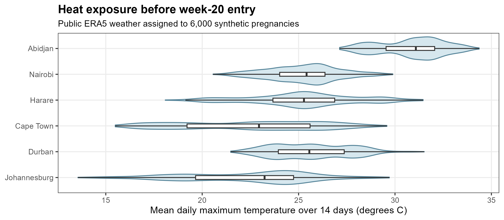
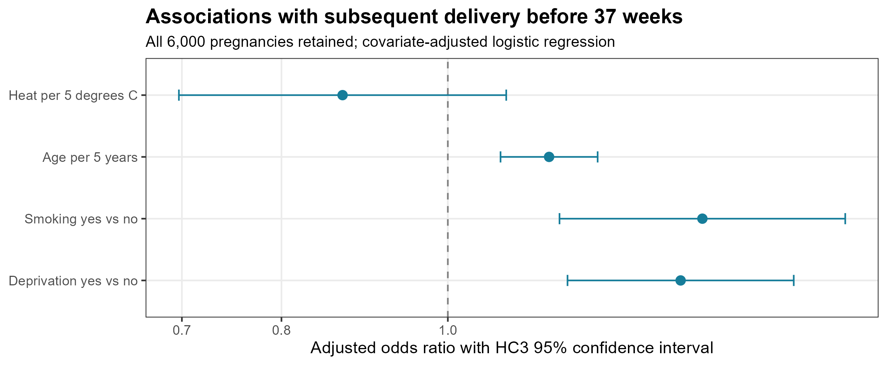
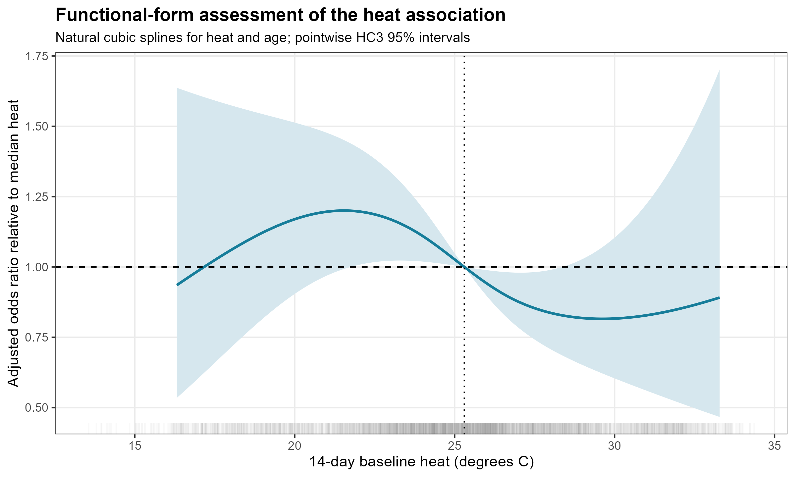
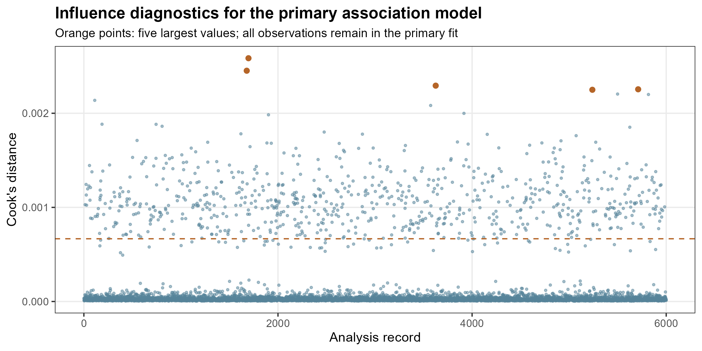
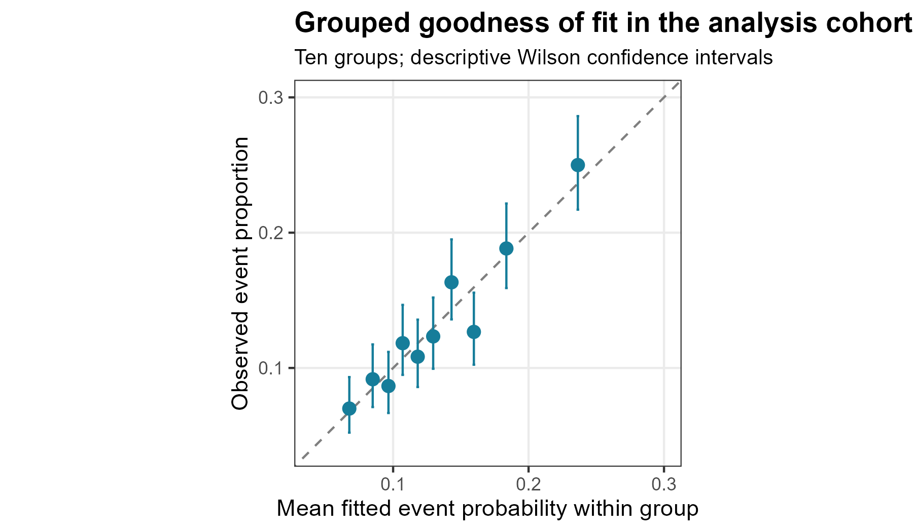

**Association study with public weather and entirely synthetic health outcomes**

```{r}
library(flextable)
```

## Abstract

**Background.** Maternal heat exposure may be associated with pregnancy outcomes, but an association analysis requires a fixed exposure window, clearly defined endpoints and appropriate covariate adjustment. This study investigated early gestational heat and subsequent delivery in a synthetic cohort linked to public historical weather.

**Methods.** We analysed 6,000 synthetic pregnancies ongoing at gestational week 20. The primary exposure was mean daily maximum temperature during the 14 completed days before entry. The primary outcome was generated delivery during weeks 20-36, coded 1, versus no delivery event through week 36, coded 0. Data preprocessing, descriptive analysis, logistic regression and diagnostics were conducted in R. Adjusted odds ratios used HC3 sandwich standard errors. Tables were generated with gtsummary and rendered in Word using flextable.

**Results.** There were 796 events among 6,000 pregnancies (13.3%). The crude heat OR per five degrees C was 1.39 (95% CI 1.26-1.54), compared with adjusted OR 0.87 (95% CI 0.70-1.08; p = 0.207). Adjusted ORs were 1.15 (95% CI 1.07-1.22; p < 0.001) for age per five years, 1.41 (95% CI 1.16-1.70; p < 0.001) for smoking and 1.37 (95% CI 1.17-1.59; p < 0.001) for deprivation. The model converged without detected separation; sensitivity analyses are reported without replacing the primary fit.

**Conclusion.** The crude positive heat association was not retained after full covariate adjustment in the primary linear model. Age, smoking and deprivation showed positive adjusted associations in this generated cohort. These results demonstrate an applied association analysis of simulated health data; they do not establish clinical effects or a protective effect of heat.

## Introduction

Heat exposure is relevant to maternal and newborn health research. A systematic review reported associations between higher temperatures during pregnancy and outcomes including preterm birth [1]. Such evidence motivates careful exposure and endpoint definitions. A temperature measurement obtained before an observation period answers a different question from a whole-pregnancy average or a time-varying exposure series.

The present study uses a single synthetic cohort to examine an epidemiological association from data preparation through interpretation. Public ERA5 weather provides the environmental measurements, while all maternal characteristics and delivery outcomes are simulated. The analysis focuses on clinical questions, descriptive findings and covariate-adjusted estimates. The original statistical-methods experiment is preserved as a separate archived release and is not the subject of this manuscript.

### Aim and objectives

The aim was to investigate the association between heat exposure before week-20 entry and subsequent delivery before week 37 in a simulated pregnancy cohort.

The objectives were to describe maternal characteristics, environmental exposure and delivery events; estimate unadjusted and adjusted heat associations; assess functional-form and other model assumptions; and examine prespecified exposure-window and adjustment sensitivities. Maternal age, smoking and deprivation associations were reported as secondary covariate findings. Delivery before week 34 was an exploratory secondary endpoint.

## Methods

### Study design and data sources

This was an association analysis of 6,000 synthetic pregnancies assigned equally across six illustrative weather locations: Johannesburg, Durban, Cape Town, Harare, Nairobi and Abidjan. The locations are environmental reference points, not clinical recruitment sites. The cohort is not a representative sample of any country or maternity service.

The existing source cohort was retained without regenerating outcomes. Its delivery intervals had been generated using gestational time, maternal characteristics and evolving weather exposure. Consequently, the baseline association evaluated here is not the same estimand as the generator's weekly heat coefficient. No parameters or participant records were changed to make the associations statistically significant.

Daily maximum temperature, minimum temperature and precipitation were obtained previously from ERA5 through the Open-Meteo Historical Weather API [2]. The saved panel covered 2019-2024 with 2,192 consecutive days per location and 13,152 site-days. Reanalysis represents gridded environmental estimates, not personal heat exposure. Health data and identifiers are entirely synthetic.

### Preprocessing and quality assessment

R imported the source CSV files and verified unique participant identifiers and site-date keys. Checks covered valid binary covariates, age and generated delivery-week ranges, complete daily weather histories, finite measurements, ordered minimum and maximum temperatures, plausible temperature bounds and nonnegative precipitation. Source age was reconstructed in years as 30 plus ten times the stored centred-age variable. Binary smoking and deprivation were encoded as labelled factors, with No as reference; outcome coding remained 0 and 1.

Exposure windows were linked by location and date. Direct summation of daily values in 60 distributed records independently checked the cumulative-sum implementation. Analysis-variable missingness was audited before selecting complete records. No duplicate, invalid or incomplete primary records were identified; no imputation or automatic outlier removal was performed. Event-interval start dates are structurally missing for non-events and were not predictors or complete-case selection variables.

```{r}
#| echo: false
#| message: false
#| warning: false
readRDS("../results/association/tables/flow_flextable.rds")
```

The final two audit rows are outcome counts, not additional exclusions. The analysis dataset, data dictionary, missingness audit and cohort accounting are retained with the R outputs. All original result files and both source datasets were checked against the frozen archive.

### Exposure and outcome definitions

Let $d_i$ be the date of week-20 entry and $T_{s_i}(d)$ the daily maximum temperature at the assigned location. The primary exposure was

$$
H_i=\frac{1}{14}\sum_{j=1}^{14}T_{s_i}(d_i-j).
$$

The entry day was excluded, and every exposure date preceded every possible generated delivery interval. This fixed window avoids defining exposure duration using the subsequent delivery date. Two seven-day subwindows were examined only as sensitivity analyses.

The primary outcome was $Y_i=1$ for a generated delivery interval beginning at gestational week 20 through 36 and $Y_i=0$ when no delivery occurred before week 37. All pregnancies were ongoing at entry and were completely observed for this generated endpoint. The stored value 37 denotes the absence of an earlier event; it is not an exact gestational age for term deliveries and was not analysed as a continuous delivery age.

The generator does not distinguish live births from pregnancy losses or spontaneous from indicated delivery. The endpoint should therefore be read as generated delivery before week 37, rather than a clinically validated preterm-birth diagnosis. The exploratory endpoint used a threshold before week 34 under the same limitations.

### Association models

The prespecified primary model was frequentist logistic regression,

$$
\log\left\{\frac{p_i}{1-p_i}\right\}=\alpha+\beta_H(H_i/5)+\beta_A\{(A_i-30)/5\}+\gamma^{\mathsf T}Z_i,
\qquad p_i=\Pr(Y_i=1\mid H_i,A_i,Z_i).
$$

The adjustment vector contained smoking, deprivation, fixed location indicators, log one plus mean precipitation during the same 14-day window, annual sine and cosine terms at entry, and calendar year centred at 2022. Johannesburg, no smoking and no deprivation were reference categories. Covariates were retained for the specified adjustment structure, rather than selected by stepwise significance testing. Separate univariable models provided the unadjusted estimates. A maternal-adjusted heat model was retained to show the effect of adding location and calendar adjustment.

The exposure odds ratio was $\exp(\beta_H)$ per 5 degrees C; the age odds ratio was per five years. Odds ratios were not interpreted as risk ratios. HC3 sandwich covariance accounted for leverage in the estimated score variability [3]. With $I=X^{\mathsf T}WX$ and logistic leverage $h_i$, the estimator was

$$
\widehat V_{HC3}=I^{-1}\left\{\sum_i\frac{x_ix_i^{\mathsf T}(Y_i-\hat p_i)^2}{(1-h_i)^2}\right\}I^{-1}.
$$

Confidence intervals were $\exp\{\hat\beta\pm1.96\operatorname{SE}_{HC3}(\hat\beta)\}$, with two-sided Wald p values. These are confidence intervals from a frequentist analysis, not posterior credible intervals. Robust standard errors do not remove confounding or correct a misspecified mean relationship.

### Model diagnostics and sensitivity analyses

Diagnostics assessed convergence, finite estimates, model-matrix rank and complete or quasi separation. Separation was checked by linear programming: a nonzero coefficient direction with nonnegative outcome-signed margins and at least one strict margin indicates separation. The implementation was checked on known complete, quasi and overlapping examples.

Heat and age linearity on the logit scale were assessed by separately replacing each linear term with a three-degree-of-freedom natural cubic spline and using a likelihood-ratio test. Normal distributions of predictors or residuals are not assumptions of logistic regression. A spline sensitivity model for both heat and age supplied a pointwise association curve relative to median heat and an exploratory interquartile contrast; this model was not selected because of its p values.

Collinearity was assessed using generalised variance-inflation factors and their degrees-of-freedom adjustment. Influence was examined with leverage and Cook's distance. The primary fit retained every eligible record. A sensitivity analysis omitted only the five largest Cook distances and disclosed the resulting sample and event counts; the screening threshold 4/N was not an exclusion rule.

Grouped goodness of fit was examined using ten fitted-probability groups and a Hosmer-Lemeshow statistic. Its p value is grouping dependent and does not prove that a model is correct. The accompanying plot describes in-sample fit rather than independent prediction performance. Additional sensitivity analyses used the separate seven-day windows and location-specific annual seasonal terms. Secondary and sensitivity findings were not multiplicity-adjusted and were treated as exploratory.

### Tables and visualisation

Descriptive characteristics were summarised as median and interquartile range or count and percentage. The gtsummary package produced the participant and regression tables [4], with a custom tidier retaining HC3 intervals and p values. These objects were converted to native editable Word tables with flextable [5]. The same displayed values were exported for the GitHub README. Figures were created with ggplot2. All statistical calculations and narrative values in this analysis were derived in R.

## Results

### Cohort characteristics and exposure

All 6,000 source pregnancies were retained, including 796 delivery events before week 37 (13.3%) and 411 before week 34 (6.9%). Entry dates ranged from 2020-01-15 to 2024-06-30. Median baseline heat was 25.3 degrees C (IQR 23.2-27.8). There were 1,000 pregnancies at each illustrative location. Table 1 describes the cohort by the primary outcome.

```{r}
#| echo: false
#| message: false
#| warning: false
readRDS("../results/association/tables/table1_flextable.rds")
```

Continuous entries are median (25th, 75th percentiles); categorical entries are n (%). Smoking and deprivation rows count Yes. Percentages are descriptive and the balanced location allocation reflects the simulation design. No inferential p values were added to the descriptive table.

The environmental distributions differed across locations, with hotter baseline conditions in Abidjan and substantial seasonal variation elsewhere. These plots describe assigned weather exposures, not geographic patterns of clinical disease.



### Heat and maternal associations

The crude heat OR was 1.39 (95% CI 1.26-1.54) per five degrees C. After adjustment for maternal characteristics, location, rainfall, season and calendar year, the OR was 0.87 (95% CI 0.70-1.08; p = 0.207). The adjusted interval included one, providing no clear evidence of a linear heat association in the primary analysis. Adjusted ORs were 1.15 (95% CI 1.07-1.22; p < 0.001) for age per five years, 1.41 (95% CI 1.16-1.70; p < 0.001) for smoking and 1.37 (95% CI 1.17-1.59; p < 0.001) for deprivation. These are differences in odds, not percentage changes in risk.

```{r}
#| echo: false
#| message: false
#| warning: false
readRDS("../results/association/tables/table2_flextable.rds")
```

Johannesburg is the location reference. Adjustment also includes rainfall, season and calendar year. Location estimates describe this synthetic design, not national clinical risks. The forest plot shows the imprecise heat estimate alongside the positive maternal covariate associations.



### Functional form and other diagnostics

The primary model converged with full rank (14 coefficients), finite estimates and no complete or quasi separation detected by linear programming. The likelihood-ratio p values for nonlinear heat and age terms were 0.101 and 0.906. These tests did not provide strong evidence against linear logit terms, but do not prove linearity. Heat had a one-degree-of-freedom VIF of 5.14 and adjusted GVIF of 2.27; this reflects overlap with the adjustment variables and should not be described as an absence of collinearity. The grouped goodness-of-fit statistic was 10.20 on 8 degrees of freedom (p = 0.251).

```{r}
#| echo: false
#| message: false
#| warning: false
readRDS("../results/association/tables/diagnostics_flextable.rds")
```

The spline curve is a sensitivity assessment of functional form, with pointwise intervals rather than a simultaneous confidence band. It assumes a common heat response across locations and does not estimate a local curve for every city. The plotted range is restricted to the pooled 1st-99th exposure percentiles; local overlap remains uneven.

The exploratory spline contrast comparing the 75th exposure percentile (27.8 degrees C) with the 25th (23.2 degrees C) gave OR 0.73 (95% CI 0.55-0.95). This differs from the prespecified constant five-degree linear contrast and is not evidence that higher heat prevents adverse outcomes. Additional contrasts were not corrected for multiplicity.



There were 747 records above the Cook distance screening threshold 4/N, with maximum Cook distance 0.0026. This low screening threshold was not used to delete records from the primary cohort. Omitting the five largest values yielded OR 0.87 (95% CI 0.70-1.09), with 5,995 pregnancies and 791 events, compared with the full-cohort OR 0.87.



The grouped plot provides a descriptive check of observed and fitted event proportions. Agreement is evaluated within the same cohort used to fit the regression and is not a validation of an operational prediction tool.



### Exposure and adjustment sensitivities

The separate seven-day windows retained imprecise fully adjusted estimates. Allowing location-specific seasonal terms gave OR 0.86 (95% CI 0.65-1.14). For the exploratory before-week-34 endpoint, the OR was 0.86 (95% CI 0.64-1.16). These checks provide context for the primary association, not independent confirmatory findings.

```{r}
#| echo: false
#| message: false
#| warning: false
readRDS("../results/association/tables/sensitivity_flextable.rds")
```

Each heat odds ratio represents a five-degree contrast within the stated window. The before-week-34 analysis uses a different exploratory outcome. The omission analysis removes five events because those records had the five largest Cook distances; it does not replace the full-cohort result. The spline interquartile contrast and linear five-degree contrast are different summaries and are not interchangeable.

## Discussion

The main finding was that the crude positive association between baseline heat and subsequent delivery before week 37 did not persist in the fully adjusted primary linear model. The change in magnitude and direction after location and calendar adjustment shows that the crude estimate was sensitive to the covariate structure. It does not prove that heat is protective or that every source of confounding has been removed.

Maternal age, smoking and deprivation had positive adjusted associations in the synthetic cohort. These relationships are coherent with the specified generator, but their recovery is not new clinical evidence. The environmental and maternal variables also have different interpretations: heat was a short baseline exposure measurement, while the outcome reflected delivery over the following gestational weeks. A baseline association cannot identify the effects of exposure occurring later in pregnancy.

The spline sensitivity suggested that a single linear coefficient does not exhaust the possible exposure pattern. Its interquartile contrast should be interpreted alongside the primary estimate and the exploratory nature of the additional analyses. Isolated intervals from a flexible curve are not sufficient to claim a protective heat effect. The workflow retains these differences rather than selecting whichever result is most statistically significant.

Strengths of the analysis include documented data import and quality checks, a fixed exposure window preceding follow-up, explicit outcome and reference coding, clinically interpretable covariate increments, native gtsummary and flextable outputs, and transparent diagnostics. Missingness and influence were assessed without manufacturing data problems or silently excluding observations. The model was estimable and the diagnostic findings were reported with their limitations.

Important limitations arise from the data themselves. All health records are simulated; clinical definitions, treatment, comorbidity, pregnancy loss and live-birth status are absent. Six balanced illustrative locations are not representative clinical centres. One reanalysis coordinate cannot measure personal temperature, housing, occupational exposure, cooling behaviour or mobility. The short baseline window does not represent all subsequent heat, and seasonal adjustment may remain incomplete. Exposure overlaps with location and season, limiting precision and interpretation of a shared coefficient. The endpoint is an interval-coded generated event, not an independently verified clinical diagnosis.

The study therefore demonstrates a complete applied analysis in R, with substantive association estimates and explicit uncertainty. Application to actual patient data would require a clinical data dictionary, validated obstetric endpoints, appropriate covariate and exposure measurement and a justified confounding strategy. These requirements cannot be met merely by choosing a more complicated statistical model.

## Conclusion

In this synthetic cohort, the adjusted primary analysis did not show clear evidence of an association between heat during the 14 days before week-20 entry and later delivery before week 37. Maternal age, smoking and deprivation showed positive adjusted associations. The crude heat association changed after location and calendar adjustment, and functional-form sensitivity warranted cautious interpretation. The study provides reproducible preprocessing, association estimates, diagnostics and publication-style tables while remaining explicitly a simulation-based applied research exercise.

## Data and code availability

The source weather and synthetic cohort are retained unchanged. The complete cleaned analysis dataset, dictionary, exclusion and missingness audit, regression estimates, model objects, diagnostics and table objects are under results/association. The ordered R scripts and run_association.R reproduce the analysis, figures and manuscript source. Native gtsummary and flextable outputs are retained with the exported tables. Weather attribution remains ERA5 through Open-Meteo under the applicable CC BY terms [2].

The complete previous methods study is frozen under archive/methods-study-v1, including its original README, code, results, figures and Word manuscript. It is historical supplementary work rather than the primary study reported here. No clinical cohort, institutional collaboration or empirical discovery is claimed. The manuscript has not undergone journal peer review.

## References

1. Chersich MF and colleagues. Associations between high temperatures in pregnancy and risk of preterm birth, low birth weight, and stillbirths. BMJ 2020;371:m3811. https://www.bmj.com/content/371/bmj.m3811
2. Open-Meteo. Historical Weather API documentation and data attribution. https://open-meteo.com/en/docs/historical-weather-api
3. Zeileis A. Econometric computing with HC and HAC covariance matrix estimators. Journal of Statistical Software 2004;11(10). https://doi.org/10.18637/jss.v011.i10
4. Sjoberg DD and colleagues. gtsummary regression and summary table documentation. https://www.danieldsjoberg.com/gtsummary/
5. Gohel D. flextable documentation. https://ardata-fr.github.io/flextable-book/

